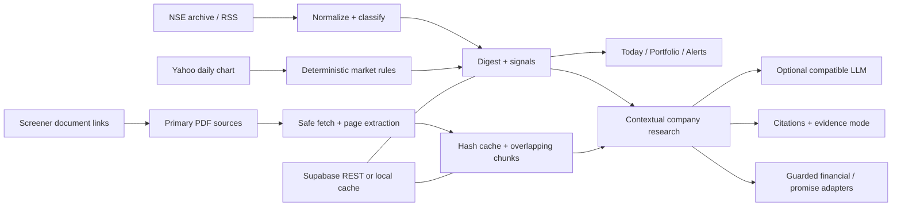

# Architecture

`src/components`: mobile/desktop views and accessible native dialog evidence panels. `src/lib`: pure calculations and rule evaluation. `src/server/providers`: public-source adapters with safe outbound fetch. `src/server/ingestion`: independently failing announcement/price orchestration. `src/server/research`: discovery, parsing, retrieval, structured optional synthesis, layout-specific financial parsing and annual guidance comparison. `src/app/api`: validated HTTP boundaries. `src/server/store.ts`: durable optional Supabase REST plus local/ephemeral fallback.

Login is the default entry; the public demo is explicit. Watchlists and personal rules are browser-local and namespaced per account. Personal alerts establish a first-visit baseline and evaluate only in a signed-in workspace; demo never creates them. Supabase email authentication uses the server-only `/api/auth` boundary, verified provider user responses and HttpOnly access/refresh cookies; it does not yet synchronize private workspaces. Scheduler state is server-side and uses the documented seed watchlist/default rules. Financial data always carries a source and accounting basis. No aggregation crosses standalone/consolidated or currency boundaries. Assertions from an earnings call remain management assertions, even when faithfully cited.

Cache records are revision keyed; HTTP bodies, document counts, download sizes, parsing pages and LLM outputs are bounded. Data source failures do not erase prior valid observations. Domain allowlisting, public IPv4 DNS resolution, validated redirects, server-only credentials and React text escaping reduce the untrusted-input surface. A production security review should add distributed rate limiting, pinned outbound networking to close DNS-rebinding races, per-user API authorization and cloud workspace persistence. The assessment app is not a broker or recommendation service.

Supabase's migration includes FK/indexed domain tables and an ingestion/document mirroring trigger. The implemented read path uses the cached normalized records; PostgreSQL full-text columns allow replacing in-process retrieval without changing citation contracts.
